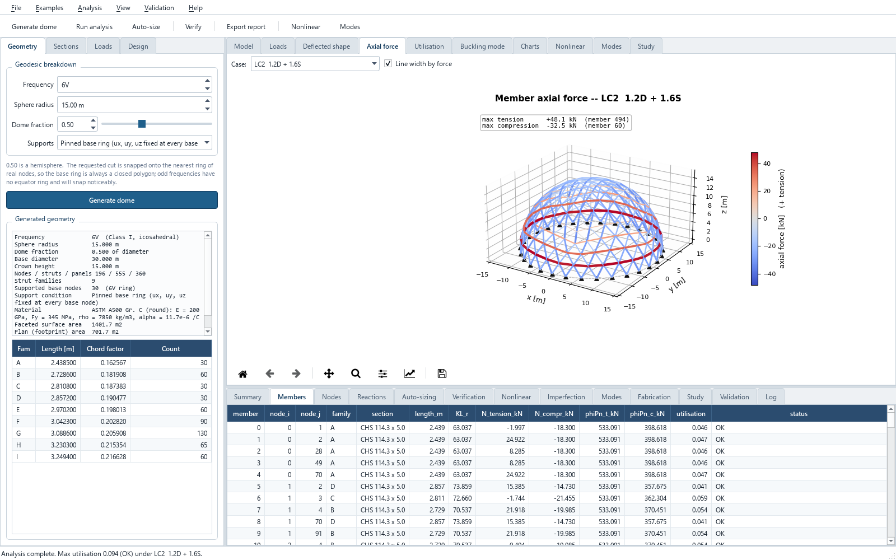
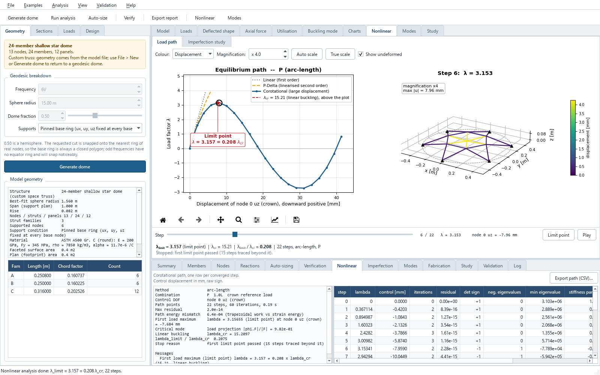
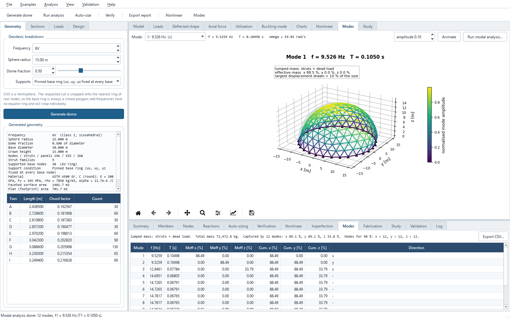
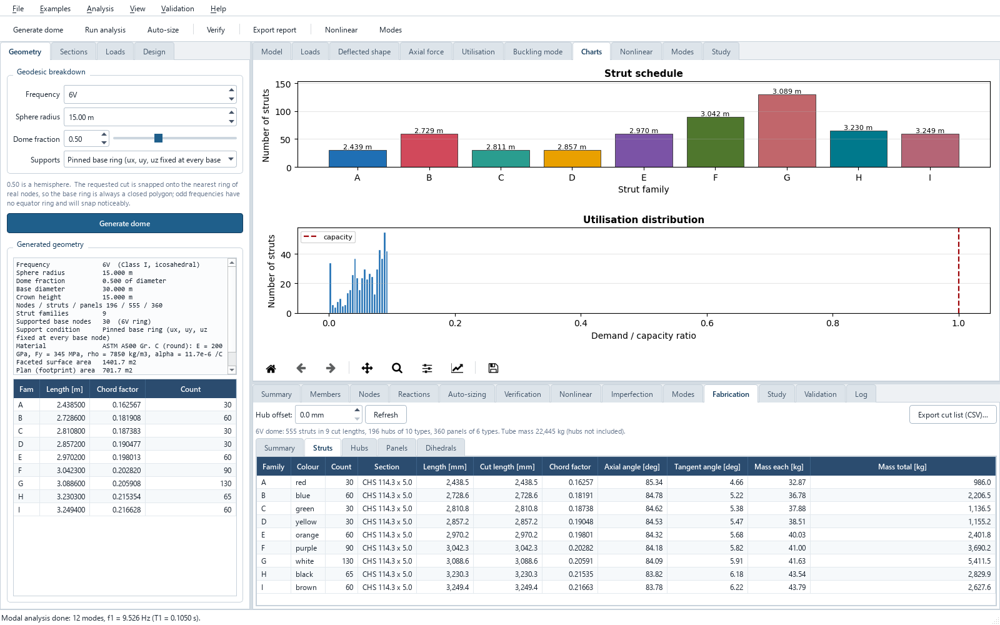

# GeoDomeLab

[](https://github.com/covdetbaba/GeoDomeLab/actions/workflows/ci.yml)
[](https://www.python.org/)
[](LICENSE)

**Analysis, stability and fabrication of single-layer geodesic domes by matrix structural analysis.**

GeoDomeLab is a Python program with a Qt window for single-layer geodesic domes
and other pin-jointed space trusses. You set the dome (frequency, radius, cut
height, supports), the tubes and the loads. The program builds the geometry,
solves it by the direct stiffness method and checks every strut to AISC 360-16.
It also finds the buckling load, traces the large-displacement path through the
limit point, computes the natural frequencies and writes the cut list for
fabrication. The program is checked against hand calculations, published
benchmarks and OpenSees. Version 2.0.0.



| Nonlinear load path of the star dome | Natural modes | Fabrication cut list |
|---|---|---|
|  |  |  |

## Features

- **Geometry.** Class I icosahedral domes from 1V to 10V, cut at any ring of
  nodes. Any other space truss can be opened from a model file or imported
  from CSV files.
- **Linear statics.** 3D truss by the direct stiffness method. Pinned, roller,
  elastic (spring) and per-node supports.
- **Loads.** Self weight, cladding dead load, snow (balanced or unbalanced),
  live load, wind normal to the surface, point and nodal loads. A uniform
  temperature change and support settlements form the self-straining load T.
  ASCE 7-16 strength combinations, all editable.
- **Member design.** AISC 360-16 tension (D2) and compression (E3, with E7 for
  slender round HSS) for every strut, enveloped over the strength
  combinations.
- **Linear buckling.** The eigenproblem [K + λ K_g] φ = 0 gives λ_cr and the
  mode shapes.
- **Geometric nonlinear analysis.** Corotational bars traced by load control,
  displacement control or Crisfield's arc-length method. Limit points,
  snap-through, P-Delta and linear paths for comparison.
- **Imperfection study.** Limit load of domes shaped like a buckling mode, for
  a list of amplitudes.
- **Modal analysis.** Natural frequencies, animated mode shapes and effective
  modal mass, with lumped or consistent mass.
- **Fabrication.** Strut cut list with chord factors and axial angles, hub
  types, panel types and dihedral angles. CSV export.
- **Parameter study.** Steel mass, utilisation, λ_cr and deflection over a
  range of frequencies, radii and dome fractions.
- **Auto-sizing.** Fully stressed design of the strut families.
- **Output.** A self-contained HTML report, CSV tables, PNG figures, JSON
  model files, DXF geometry for CAD and standalone OpenSeesPy scripts.
- **Checks built in.** Verification suite, hand-calculation validation and the
  OpenSees cross-check run from the Validation menu.

## Quick start

You need Python 3.10 or newer.

```bash
git clone https://github.com/covdetbaba/GeoDomeLab.git
cd GeoDomeLab
pip install -r requirements.txt
python run_geodome.py
```

Or install it as a command:

```bash
pip install -e .
geodomelab                 # the same as: python -m geodome
```

With conda: `conda env create -f environment.yml`, then
`conda activate geodomelab`.

In Spyder, open `run_geodome.py` and press F5. If the window freezes, set
Tools > Preferences > IPython console > Graphics > Backend to Qt (or
Automatic) and restart the kernel.

Other options (they also work with `geodomelab` and `python -m geodome`):

```bash
python run_geodome.py --verify               # the 75-check verification suite
python run_geodome.py --demo                 # the worked case study, no window
python run_geodome.py --batch 6 15 0.5 out   # analyse a dome, write all results to out/
python run_geodome.py --help
```

The optional OpenSees cross-check needs `pip install openseespy`
(or `pip install -e ".[opensees]"`).

The user guide is in [docs/USER_GUIDE.md](docs/USER_GUIDE.md).

## Check it yourself

One command runs every test, the verification suite, both hand-calculation
validations and, when OpenSees is installed, the quick OpenSees cross-check:

```bash
python run_all_checks.py
```

It prints one line per step and a table, and exits with code 0 only when
everything passes. Qt runs offscreen, so no window opens. The run on
16 November 2026 (Windows, Python 3.13) gave:

| Step | Result |
|---|---|
| Unit and GUI tests (17 files) | 317 of 317 pass, 1 skipped |
| Verification suite (`run_geodome.py --verify`) | 75 of 75 pass |
| Hand calculation, Models A and B (`validation/run_validation.py`) | 80 of 80 pass |
| Hand calculation file F1-F10, internal checks (`validation/hand_calc_ext.py`) | 120 of 120 pass |
| Program vs hand calculation F1-F10 (`validation/run_validation_ext.py`) | 422 of 422 pass |
| OpenSees cross-check, quick set (`validation/opensees_crosscheck.py --quick`) | 486 of 486 pass |
| **Overall** | **PASS, 1500 of 1500 checks** |

The skipped test compares two ways of running OpenSees and needs both of them.
Without OpenSees the OpenSees steps are skipped, not failed. The same command
runs on GitHub Actions for every push, on Ubuntu and Windows with Python 3.11
and 3.12.

## Validation summary

How each check works is in [docs/VALIDATION.md](docs/VALIDATION.md). The
numbers below come from the files in `validation/output/` and from the run
above.

| What is checked | Reference | Comparisons | Worst difference |
|---|---|---|---|
| Built-in verification suite | closed-form bars and tripod, published chord factors, Euler and Maxwell counts, method of sections, membrane theory, identities | 75 | closed forms 2.4e-16 (relative); membrane theory 2.6 % (an approximation, 5 % allowed) |
| Linear statics of two small domes, Models A and B | hand calculation (`validation/hand_calc.py`) | 80 | 1.2e-13 % |
| Temperature, settlement, springs, force method, von Mises path, frequencies, 2V angles, wind field, AISC E3/E7/B4.2 strength (F1-F10) | hand calculation (`validation/hand_calc_ext.py`), which does not import the program | 422 | linear 1.2e-13, modal 7.0e-16, nonlinear path 4.9e-10 (relative) |
| 24-member star dome snap-through | Greco & Venturini (2006), Iu & Bradford (2012) | first limit point and first zero-load state | limit at 0.768 cm (published: near 0.75 cm); zero load at 1.88 cm, node 2 up 0.116 cm (published: about 19 mm and 1.16 mm) |
| von Mises two-bar truss | exact closed form, derived here (the problem of Pecknold et al. 1985) | part of F6 | 4.9e-10 along the path |
| Chord factors 2V to 8V | Kenner (1976) and the closed forms for 2V; the Domerama chord-factor chart for 3V to 8V | 2V and 4V in the suite, 2V to 8V in the tests | 2V to 6V within the printed decimals; 7V and 8V within 1e-5 |
| Statics, modes and nonlinear paths of 1V to 8V domes and benchmarks | OpenSees 3.8.0 (`corotTruss`, `eigen`) | 1069 | statics 2.19e-13, frequencies 2.72e-13, nonlinear λ 4.14e-11 (relative) |

OpenSees shares only the input data with GeoDomeLab: nodes, members, E and A,
supports, the factored load vector, thermal strains, settlements and masses.
It does not check the load generation, the AISC checks or λ_cr. The hand
calculations cover the dead, snow and wind load generation (Models A and B,
F9), the AISC checks (Model A, F10) and λ_cr (Model A). The unbalanced snow
pattern and the default combination factors are checked by unit tests only,
and the wind Cp table is an illustrative simplification.

## Examples

The **Examples** menu loads ready models with known answers. Hover over an
entry to read what it checks.

| Example | What it shows |
|---|---|
| Validation Model A, 1V pentagonal cap | 3 free DOF, solved by hand with every matrix written out |
| Validation Model B, 1V dome on its lower ring | 18 free DOF, solved by hand with five-fold symmetry |
| von Mises two-bar truss | snap-through; λ_cr overestimates the true limit load 5.2 times |
| 24-member shallow star dome | the classic snap-through benchmark; λ_cr is 4.8 times too high |
| Planar three-bar truss | temperature and settlement in an indeterminate truss, checked by the force method |
| Case study, 6V dome, 30 m span | the worked example of the report |

The same models are saved in `examples/models/*.json` (open them with File >
Open). The Examples menu builds the models in code, so it works without these
files. The `examples/` and `validation/` folders are not part of the installed
package. They are used in place from the clone, which `pip install -e .` keeps.
`examples/csv_truss/` is a small pyramid roof in the CSV import format.
`examples/worked_example.py` analyses, auto-sizes and reports the 6V case
study without the window (`python run_geodome.py --demo`).

## Project layout

```
GeoDomeLab/
├── run_geodome.py            launcher: GUI, --verify, --demo, --batch
├── run_all_checks.py         runs every test and validation, prints PASS/FAIL
├── pyproject.toml            package metadata (pip install -e .)
├── requirements.txt          pip requirements
├── environment.yml           conda environment
├── geodome/                  the program
│   ├── geometry.py           Class I geodesic geometry, custom trusses
│   ├── model.py              DomeModel, load cases, JSON files
│   ├── materials.py          steel and aluminium grades
│   ├── sections.py           circular hollow section catalogue
│   ├── loads.py              dead, snow, live, wind and nodal loads
│   ├── solver.py             direct stiffness solver, geometric stiffness
│   ├── buckling.py           AISC 360-16 checks, linear buckling
│   ├── nonlinear.py          corotational path tracing, imperfections
│   ├── modal.py              natural frequencies and modal mass
│   ├── fabrication.py        cut list, hubs, panels, angles
│   ├── study.py              parameter studies
│   ├── optimize.py           fully stressed auto-sizing
│   ├── benchmarks.py         the example models and their reference answers
│   ├── csv_import.py         CSV truss import
│   ├── cad.py                DXF export
│   ├── opensees_bridge.py    OpenSees cross-check and script export
│   ├── postprocess.py, plotting.py, report.py, verification.py, units.py
│   ├── __main__.py           python -m geodome
│   └── gui/                  Qt window and its add-on views
├── examples/                 worked example, model files, CSV example
├── validation/               hand calculations, comparisons, OpenSees cross-check
│   └── output/               the comparison tables (Markdown and CSV)
├── tests/                    unit and GUI tests (run alone or with pytest)
├── docs/                     user guide, validation, theory, images
├── .github/workflows/ci.yml  GitHub Actions
├── CITATION.cff
└── LICENSE
```

## Documentation

- [User guide](docs/USER_GUIDE.md): every menu, panel and tab, the input
  formats, a first analysis step by step, and troubleshooting.
- [Validation](docs/VALIDATION.md): how the program is verified and
  validated, with the numbers.
- [Theory](docs/THEORY.md): the methods and equations, with references.

## How to cite

If you use GeoDomeLab or its results, please cite it. GitHub shows a "Cite
this repository" button built from [CITATION.cff](CITATION.cff). In text:

> Babazade, J. (2026). *GeoDomeLab: analysis, stability and fabrication of
> single-layer geodesic domes by matrix structural analysis* (Version 2.0.0)
> [Computer software]. https://github.com/covdetbaba/GeoDomeLab

## License

All rights reserved by Jovdat Babazade. GeoDomeLab is free to use for your
own calculations, study, teaching and research, with credit to the author.
Credit it as "GeoDomeLab, developed by Jovdat Babazade" with the repository
address. Do not republish, sell or claim it as your own. See
[LICENSE](LICENSE) for the full terms.

## Engineering disclaimer

GeoDomeLab is a tool for structural analysis and preliminary design. It is
provided as is, with no warranty. Check every result. A qualified engineer
must review and approve any design and is responsible for the final structure
under the codes that apply to it.

## Author

Jovdat Babazade, Louisiana State University.

GeoDomeLab began as the final project of CE 7405, Statically Indeterminate
Structures, at LSU (2026). It was developed with the help of an AI coding
assistant, as the course policy allows. The disclosure is in
[docs/ai_acknowledgment.md](docs/ai_acknowledgment.md).
